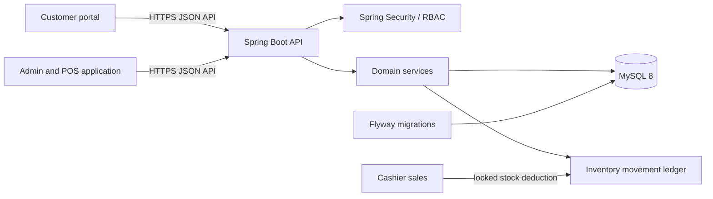

# System Architecture

Frontend clients use `/api/v1`. Controllers accept and return DTOs; services enforce business rules and authorization; repositories access MySQL. Flyway is the schema authority. See [[Backend Architecture]] and [[Frontend Architecture]].
