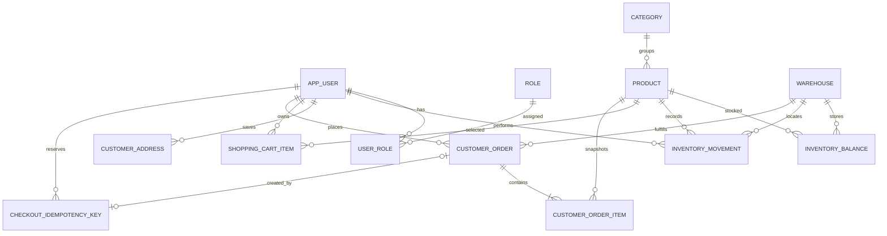

# Entity Relationships

These relationships match the authored V1-V3 migrations and JPA mappings. MySQL migration execution and schema validation remain unverified because no database account has been provisioned.
